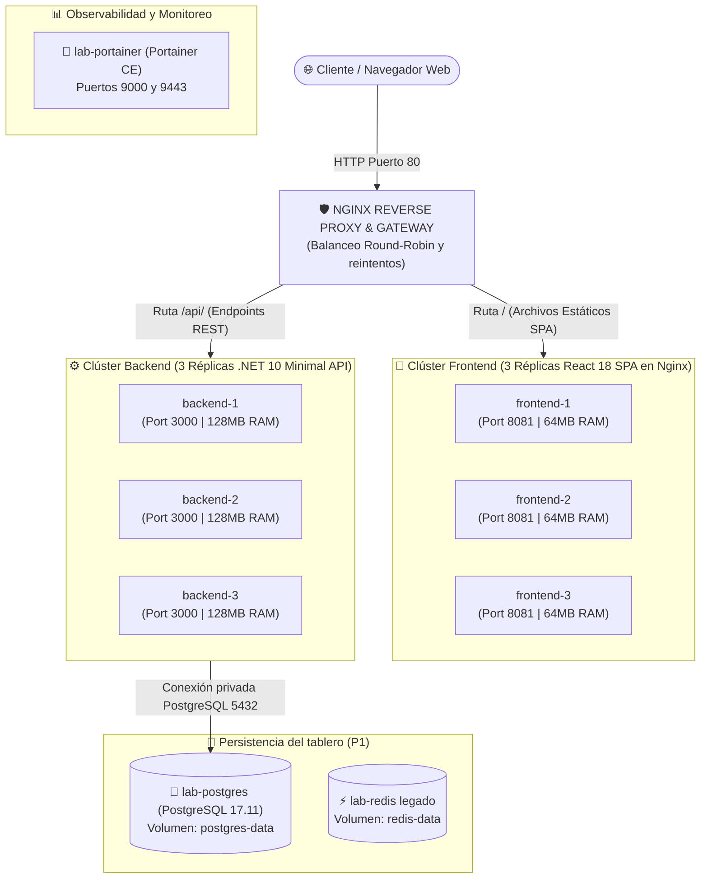

# 🚀 Clúster de Microservicios, PostgreSQL y DevSecOps Lab
### UTN FRRe | DevOps – Cultura, Herramientas y Procesos | Ciclo Lectivo 2026

[]
[](https://maxivalenzano.github.io/dev-ops-clase-2/presentacion/)
[-red?style=flat&logo=markdown&logoColor=white)](INFORME_TP1.md)
[](https://dev.azure.com/maxivalenzano/DevOps/_build/latest?definitionId=1&branchName=devel)
[](https://sonarcloud.io/summary/new_code?id=maxivalenzano_DevOps)
[](https://sonarcloud.io/summary/new_code?id=maxivalenzano_DevOps)
[](https://sonarcloud.io/summary/new_code?id=maxivalenzano_DevOps)
[](https://sonarcloud.io/summary/new_code?id=maxivalenzano_DevOps)
[](https://github.com/maxivalenzano/dev-ops-clase-2/releases)
[](backend/)
[](frontend/)
[](compose.yaml)
[](nginx/)

---

## 🌟 Enlaces y destino de despliegue

* 🎓 **Presentación Técnica y Defensa Oficial**: [GitHub Pages — Presentación Online](https://maxivalenzano.github.io/dev-ops-clase-2/presentacion/)
* ☁️ **Aplicación en EC2**: [http://18.216.227.211](http://18.216.227.211), release `3.1.6-build.91` (P3). La IP pública puede cambiar.
* 🛠️ **Estado de despliegue**: P1, P2 y P3 se desplegaron sucesivamente; P3 está activa con PostgreSQL. Pasaron las pruebas manuales de resiliencia, backup/restore off-host y rollback P3→P1→P3; Redis se conserva como legado.
* 📄 **Informe Académico Formal del TP 1**: [INFORME_TP1.md](INFORME_TP1.md)
* 🛡️ **Dashboard de Calidad y Seguridad**: [SonarQube Cloud](https://sonarcloud.io/summary/new_code?id=maxivalenzano_DevOps)
* 📚 **Documentación Técnica y Bitácora**: [VitePress Docs](https://maxivalenzano.github.io/dev-ops-clase-2/)

---

## 🗺️ 1. Mapa Conceptual de la Arquitectura (Primer Pantallazo)

El diagrama muestra la topología activa desde P1: PostgreSQL es la fuente de verdad del tablero. El servicio y volumen Redis se conservan como legado y no reciben nuevas escrituras.



---

## 🏛️ 2. Topología desplegada y persistencia

La aplicación tiene tres réplicas frontend y tres backend. PostgreSQL corre como infraestructura persistente de un proyecto Compose separado; el stage P1 informó diez servicios healthy y la verificación CD pasó. Redis se conserva como legado fuera del flujo de escritura actual.

| Contenedor | Rol en el Sistema | Tecnología | Puerto Interno | Límites de Recursos |
| :--- | :--- | :--- | :---: | :---: |
| **`lab-nginx`** | Gateway, Proxy Reverso y Balanceador L7 | Nginx Alpine | `${PORT:-80}:80` |
| **`lab-frontend-1`** | Réplica 1 de la Interfaz Web SPA | React 18 / Vite / Nginx | `8081` | 0.25 CPU / 64 MB RAM |
| **`lab-frontend-2`** | Réplica 2 de la Interfaz Web SPA | React 18 / Vite / Nginx | `8081` | 0.25 CPU / 64 MB RAM |
| **`lab-frontend-3`** | Réplica 3 de la Interfaz Web SPA | React 18 / Vite / Nginx | `8081` | 0.25 CPU / 64 MB RAM |
| **`lab-backend-1`** | Réplica 1 de la API REST (`backend-dotnet-1`) | .NET 10 C# Minimal API | `3000` | 0.50 CPU / 128 MB RAM |
| **`lab-backend-2`** | Réplica 2 de la API REST (`backend-dotnet-2`) | .NET 10 C# Minimal API | `3000` | 0.50 CPU / 128 MB RAM |
| **`lab-backend-3`** | Réplica 3 de la API REST (`backend-dotnet-3`) | .NET 10 C# Minimal API | `3000` | 0.50 CPU / 128 MB RAM |
| **`lab-redis`** | Almacén legado previo a P1, sin nuevas escrituras | Redis 7 Alpine | Interno, no publicar | Volumen `redis-data` conservado |
| **`lab-postgres`** | Fuente de verdad activa desde P1 | PostgreSQL 17.11 | Interno, sin puerto público | Volumen `postgres-data` |
| **`lab-portainer`** | Panel Gráfico de Gestión de Contenedores | Portainer CE | `127.0.0.1:9000:9000`, `127.0.0.1:9443:9443` en EC2 | Volumen `portainer-data` |

> PostgreSQL es la fuente de verdad del tablero desde P1. La inspección previa al corte encontró Redis vacío; Redis y su volumen se conservan como legado. Mantenerlos no sincroniza cambios posteriores.

---

## 🖥️ 3. ¿Cómo Usar la Aplicación en la Web? (Guía Paso a Paso)

Al abrir la aplicación encontrarás dos modos principales accesibles desde la barra superior. En local, se accede en `http://localhost`; la demo en EC2 está disponible por HTTP en [http://18.216.227.211](http://18.216.227.211). Dominio y HTTPS de aplicación son opcionales y todavía no están validados.

### 📋 Modo 1: Tablero Distribuido ("Node Signature Board")

El tablero comparte tareas entre sus tres backends. Desde P1, la API las persiste en PostgreSQL mediante EF Core.

```text
┌────────────────────────────────────────────────────────────────────────┐
│  🟢 Frontend Node: frontend-react-2   |   🔄 Última lectura: backend-dotnet-1  │
├────────────────────────────────────────────────────────────────────────┤
│  [ Escribe una nueva tarea... ]   [ + Guardar en Clúster ]             │
│                                                                        │
│  Tareas en PostgreSQL (3):                                             │
│  [x] Configurar Nginx Reverse Proxy      🏷️ Creado por: backend-dotnet-1 │
│  [ ] Validar Failover con docker stop    🏷️ Creado por: backend-dotnet-3 │
│  [ ] Pruebas SAST con SonarQube Cloud    🏷️ Creado por: backend-dotnet-2 │
└────────────────────────────────────────────────────────────────────────┘
```

1. **Crear una Tarea:**
   * Escribe un título en el campo de texto y haz clic en **Guardar en Clúster**.
   * Nginx balanceará la petición a uno de los 3 nodos backend (`POST /api/tasks`).
   * Verás que la tarjeta creada tiene un **badge de color único** con el nombre del nodo que la estampó (`createdByNode: backend-dotnet-X`).
2. **Consultar y Actualizar:**
   * Al recargar la página (F5), Nginx balanceará la lectura (`GET /api/tasks`) a otro nodo.
   * El banner superior te indicará en vivo: **"Última lectura atendida por: [Nodo]"**.
   * Todas las tareas se muestran juntas porque las réplicas usan PostgreSQL como persistencia compartida.
3. **Completar o Eliminar:**
   * Haz clic en el checkbox para tachar una tarea (`PUT /api/tasks/{id}/toggle`) o en el cesto de basura para borrarla (`DELETE /api/tasks/{id}`).
4. **🔥 Prueba de Resiliencia en Vivo:**
   * Apaga un nodo backend en la consola: `podman compose stop backend-1`.
   * Prueba crear y listar tareas mientras quedan activas las otras réplicas.

---

### ⚡ Modo 2: Laboratorio de Caos y Métricas ("ChaosLab")

Haz clic en la pestaña **Laboratorio de Caos** para probar la robustez de Nginx y los límites de los contenedores:

| Experimento | ¿Qué hace? | ¿Cómo probarlo en la Web? | Resultado Esperado |
| :--- | :--- | :--- | :--- |
| **⚖️ Balanceo de Carga** | Envía ráfagas concurrentes a la API. | Configura `50` peticiones y pulsa **Lanzar Prueba**. | El gráfico de barras muestra la distribución equitativa de peticiones (~33% a cada backend). |
| **⏱️ Timeout de Gateway** | Simula demoras deliberadas en la respuesta. | Selecciona **6000 ms (6s)** y pulsa **Enviar Request**. | Nginx corta la conexión a los 5s y muestra un error JSON estructurado **504 Gateway Timeout**. |
| **💾 Estrés de memoria** | Fuerza al backend a reservar memoria. | Usa el control de memoria y observa el nodo. | Las réplicas tienen un límite configurado de 128 MB; el resultado depende del proceso y del host. |
| **🔥 Estrés de CPU** | Ejecuta un bucle de cómputo durante el tiempo elegido. | Haz clic en **Estrés CPU**. | Mide el tiempo de respuesta y el comportamiento bajo carga. |
| **🩺 Toggle de Salud** | Simula que un backend se declara enfermo. | Haz clic en **Alternar Salud (UP/DOWN)**. | El nodo responde con código `500`. Nginx detecta el fallo y reenvía la petición al siguiente nodo sano de forma transparente. |

---

## 🔄 4. Pipeline CI/CD y DevSecOps

El pipeline actual de **Azure DevOps** (`azure-pipelines.yml`) tiene cinco stages y bloquea el despliegue cuando falla QualityGate o PostgreSQL:

```mermaid
flowchart LR
    Dev(["👨‍💻 Desarrollador"]) -->|"git push"| GitRepo["🐙 GitHub (devel / main)"]
    GitRepo -->|"Webhook Trigger"| Pipeline["⚡ Azure Pipelines Multi-Stage"]

    subgraph S1 ["Stage 1: Versioning"]
        SemVer["🏷️ Versión y SHA"]
    end

    subgraph S2 ["Stage 2: Quality Gate & SAST"]
        direction TB
        Tests["🧪 Tests .NET + integración PostgreSQL"]
        Coverage["📊 Cobertura"]
        Sonar["🛡️ SonarQube Cloud SAST"]
        Trivy["🔍 Trivy Container Scanner"]
        Gate{"Compuerta de Calidad<br/>(Quality Gate)"}

        Tests --> Coverage --> Sonar --> Gate
        Trivy --> Gate
    end

    subgraph S3 ["Stage 3: Packaging OCI"]
        direction TB
        GHCR["📦 Backend, frontend y migrador<br/>mismo SHA en GHCR"]
    end

    subgraph S4 ["Stage 4: PostgreSQL"]
        direction TB
        DB["☁️ EC2: backup, migración<br/>y validación de esquema"]
    end
    subgraph S5 ["Stage 5: CD"]
        VM["☁️ EC2: despliegue de aplicación"]
        Smoke["🩺 Readiness y verificación"]
    end

    Pipeline --> S1
    S1 --> S2
    Gate -->|"Quality Gate: PASA"| S3
    Gate -.->|"Fallo de Calidad"| Abort["❌ Abortar Pipeline (Fail-Fast)"]
    S3 --> S4 --> S5
    VM --> Smoke
```



1. **Versioning** define la etiqueta SemVer y el SHA que producen las imágenes.
2. **QualityGate** ejecuta análisis y pruebas con PostgreSQL descartable; un fallo bloquea Packaging y despliegue.
3. **Packaging** publica backend, frontend y migrador del mismo SHA.
4. **PostgreSQL** respalda y migra el esquema en EC2, y publica evidencia.
5. **CD** despliega la aplicación compatible y verifica readiness.

El pipeline no selecciona fases ni IDs de migración. Packaging genera un manifiesto desde las migraciones EF del código; PostgreSQL aplica en orden todas las que falten hasta la última incluida en ese build. Los releases P1/P2/P3 que aparecen en la bitácora son evidencia histórica, no parámetros del pipeline.

P1, P2 y P3 completaron los cinco stages en secuencia; P3 es la versión activa. Build91 reportó 49/49 unitarias y 13/13 integración, incluyendo 503 por Nginx al detener PostgreSQL. También pasaron la prueba manual de resiliencia y el rollback P3→P1→P3.

### Configuración de Azure DevOps

Los secretos `GHCR_PUSH_TOKEN`, `GHCR_PULL_TOKEN` y `GITHUB_RELEASE_TOKEN` ya están configurados en Azure DevOps. Los permisos de GHCR funcionan y el agente Linux `ec2-devops` está registrado en el Environment `devops-ec2-env`.

---

## ⚡ 5. Ejecutar y desplegar

### Despliegue en EC2 mediante Azure Pipelines

El flujo tiene cinco stages: `Versioning → QualityGate → Packaging → PostgreSQL → CD`. Para solicitar un despliegue manual en EC2, iniciar una ejecución desde Azure DevOps con `deployDemo=true`. No hay selector de fase ni destino de migración: una base nueva recibe todas las migraciones y una existente avanza solo por las pendientes. P3 (`3.1.6-build.91`) es el último despliegue documentado; ver la [bitácora histórica](docs/bitacora/2026-10-25-postgresql-ef-migraciones.md).

### Pruebas locales de integración

En un entorno Linux con Docker disponible, ejecuta el script de integración. Construye una imagen backend y el migrador, y prueba la aplicación incremental contra PostgreSQL descartable; no usa la base EC2:

```bash
bash scripts/test-postgresql.sh
```

La suite backend local se ejecuta con [.NET 10 SDK](https://dotnet.microsoft.com/):

```bash
dotnet test tests/Backend.Tests/Backend.Tests.csproj
```

Podman sobre Windows/WSL presenta una limitación de red observada en este entorno y no está validado como ruta para ejecutar este stack. Para la integración PostgreSQL, usar Linux y Docker.

---

---

## 🧪 6. Estado de pruebas

En el commit `07e6c9a`, las pruebas backend locales pasaron **49/49**. El build 87 reportó 46 unitarias y 13 de integración aprobadas. Builds 89 y 90 bloquearon la promoción por fallo de gateway; build91 pasó sus cinco stages, con 49 unitarias y 13 de integración, incluido el 503 vía Nginx. También pasaron las pruebas manuales de resiliencia, backup/restore off-host y rollback P3→P1→P3; consultar la [bitácora](docs/bitacora/2026-10-25-postgresql-ef-migraciones.md).

---

## 📚 7. Documentación Técnica y Bitácora del Proyecto

La integración PostgreSQL/EF Core está desplegada hasta P3. Consulta el [plan](docs/backend/plan-integracion-postgresql-ef.md), el [guion de migraciones](docs/backend/migraciones-demo.md) y la [bitácora con evidencia por build](docs/bitacora/2026-10-25-postgresql-ef-migraciones.md).

### Estado actual de EC2

P3 (`3.1.6-build.91`) está activo con esquema `20261025000400_004_RequirePriority`. Las fases P1, P2 y P3 se desplegaron sucesivamente y completaron los cinco stages; el build91 aplicó el backfill y preservó los datos del marcador. Redis se conserva como legado y no recibe escrituras nuevas. También se verificaron resiliencia, restore off-host y rollback P3→P1→P3.

P1 (`3.1.1-build.87`) inicializó PostgreSQL y P2 (`3.1.2-build.88`) avanzó el esquema. P3 (`3.1.6-build.91`) aplicó backfill y restricciones; el rollback real a P1 y el retorno a P3 conservaron el marcador con prioridad 3. Luego se eliminó por API y el tablero quedó vacío. Un backup P3 descargado desde Azure Pipelines se verificó por SHA-256 y se restauró en una base separada; el tiempo medido fue 0,462 s en esta prueba, no un RTO general.

Las entradas anteriores sobre `3.0.0`, build81, cuatro stages y Redis describen el historial pre-PostgreSQL; no son el estado activo.

El repositorio cuenta con un sitio web de documentación integral generado con **VitePress**:

```bash
# Iniciar servidor local de documentación con hot-reload
npm run docs:dev

# Compilar documentación para producción
npm run docs:build
```

---

## 👥 Datos Académicos

* **Asignatura:** DevOps – Cultura, Herramientas y Procesos (Ciclo 2026)
* **Institución:** Universidad Tecnológica Nacional – Facultad Regional Resistencia (UTN FRRe)
* **Docente:** Prof. Ing. Jose A. Fernandez
* **Estudiante:** Maximiliano Nicolas Valenzano (Legajo: 21664)
* **Informe Completo para Evaluación:** [INFORME_TP1.md](INFORME_TP1.md)
