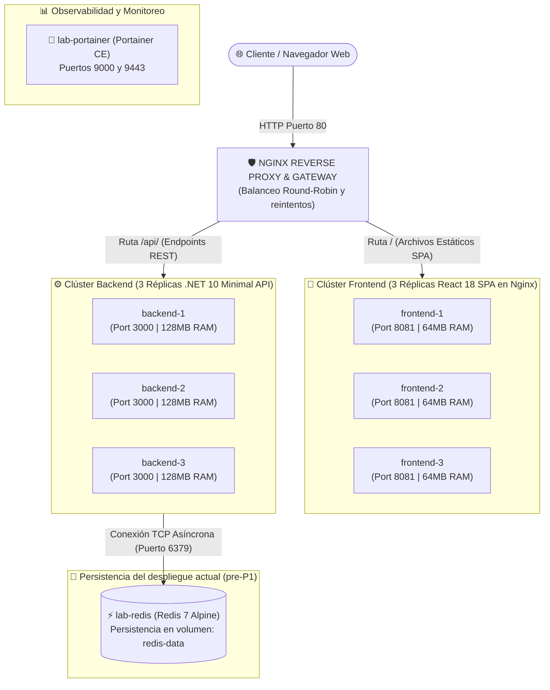
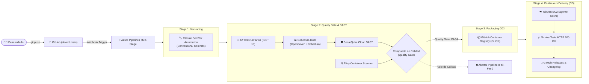

# 🚀 Clúster de Microservicios, PostgreSQL y DevSecOps Lab
### UTN FRRe | DevOps – Cultura, Herramientas y Procesos | Ciclo Lectivo 2026

[]
[](https://maxivalenzano.github.io/dev-ops-clase-2/presentacion/)
[-red?style=flat&logo=markdown&logoColor=white)](INFORME_TP1.md)
[](https://dev.azure.com/maxivalenzano/DevOps/_build/latest?definitionId=1&branchName=devel)
[](https://sonarcloud.io/summary/new_code?id=maxivalenzano_DevOps)
[](https://sonarcloud.io/summary/new_code?id=maxivalenzano_DevOps)
[](https://sonarcloud.io/summary/new_code?id=maxivalenzano_DevOps)
[](https://sonarcloud.io/summary/new_code?id=maxivalenzano_DevOps)
[](https://github.com/maxivalenzano/dev-ops-clase-2/releases)
[](backend/)
[](frontend/)
[](compose.yaml)
[](nginx/)

---

## 🌟 Enlaces y destino de despliegue

* 🎓 **Presentación Técnica y Defensa Oficial**: [GitHub Pages — Presentación Online](https://maxivalenzano.github.io/dev-ops-clase-2/presentacion/)
* ☁️ **Aplicación en EC2**: [http://18.216.227.211](http://18.216.227.211), versión `3.0.0-build.81`; nueve contenedores están en estado running. La IP pública puede cambiar.
* 🛠️ **Estado de despliegue**: EC2 conserva la entrega anterior basada en Redis hasta completar el corte P1. La integración PostgreSQL/EF Core y sus cinco stages están en el repositorio; los resultados de CI/CD y del nuevo despliegue se agregarán tras su confirmación.
* 📄 **Informe Académico Formal del TP 1**: [INFORME_TP1.md](INFORME_TP1.md)
* 🛡️ **Dashboard de Calidad y Seguridad**: [SonarQube Cloud](https://sonarcloud.io/summary/new_code?id=maxivalenzano_DevOps)
* 📚 **Documentación Técnica y Bitácora**: [VitePress Docs](https://maxivalenzano.github.io/dev-ops-clase-2/)

---

## 🗺️ 1. Mapa Conceptual de la Arquitectura (Primer Pantallazo)

El diagrama muestra la topología EC2 actualmente desplegada, que sigue usando Redis mientras PostgreSQL P1 no se haya aplicado. El servicio y volumen Redis se conservan como legado y respaldo de transición; el destino es PostgreSQL.



---

## 🏛️ 2. Topología desplegada y destino PostgreSQL

La entrega existente usa **9 contenedores** conectados por `lab-network`; backend y frontend tienen tres réplicas cada uno. Este estado histórico de despliegue conserva Redis. La configuración nueva separa la infraestructura persistente PostgreSQL en `compose.data.yaml`, fuera del rollback de aplicación; su activación en EC2 queda pendiente de verificación del stage P1.

| Contenedor | Rol en el Sistema | Tecnología | Puerto Interno | Límites de Recursos |
| :--- | :--- | :--- | :---: | :---: |
| **`lab-nginx`** | Gateway, Proxy Reverso y Balanceador L7 | Nginx Alpine | `${PORT:-80}:80` |
| **`lab-frontend-1`** | Réplica 1 de la Interfaz Web SPA | React 18 / Vite / Nginx | `8081` | 0.25 CPU / 64 MB RAM |
| **`lab-frontend-2`** | Réplica 2 de la Interfaz Web SPA | React 18 / Vite / Nginx | `8081` | 0.25 CPU / 64 MB RAM |
| **`lab-frontend-3`** | Réplica 3 de la Interfaz Web SPA | React 18 / Vite / Nginx | `8081` | 0.25 CPU / 64 MB RAM |
| **`lab-backend-1`** | Réplica 1 de la API REST (`backend-dotnet-1`) | .NET 10 C# Minimal API | `3000` | 0.50 CPU / 128 MB RAM |
| **`lab-backend-2`** | Réplica 2 de la API REST (`backend-dotnet-2`) | .NET 10 C# Minimal API | `3000` | 0.50 CPU / 128 MB RAM |
| **`lab-backend-3`** | Réplica 3 de la API REST (`backend-dotnet-3`) | .NET 10 C# Minimal API | `3000` | 0.50 CPU / 128 MB RAM |
| **`lab-redis`** | Persistencia de tareas de la entrega anterior; se conserva para el corte inicial | Redis 7 Alpine | Interno, no publicar | Volumen `redis-data` |
| **`lab-postgres`** | Persistencia de destino, en proyecto Compose separado | PostgreSQL 17.11 | Interno, sin puerto público | Volumen `postgres-data` |
| **`lab-portainer`** | Panel Gráfico de Gestión de Contenedores | Portainer CE | `127.0.0.1:9000:9000`, `127.0.0.1:9443:9443` en EC2 | Volumen `portainer-data` |

> Mientras P1 no esté confirmado en EC2, Redis sigue siendo la fuente de verdad del despliegue existente. El primer corte P1 importa las tareas preservando IDs; después PostgreSQL será la fuente de verdad y Redis quedará legado sin recibir escrituras nuevas. Mantener el volumen Redis no sincroniza los cambios posteriores.

---

## 🖥️ 3. ¿Cómo Usar la Aplicación en la Web? (Guía Paso a Paso)

Al abrir la aplicación encontrarás dos modos principales accesibles desde la barra superior. En local, se accede en `http://localhost`; la demo en EC2 está disponible por HTTP en [http://18.216.227.211](http://18.216.227.211). Dominio y HTTPS de aplicación son opcionales y todavía no están validados.

### 📋 Modo 1: Tablero Distribuido ("Node Signature Board")

El tablero comparte tareas entre sus tres backends. La entrega anterior las almacenaba en Redis; la versión PostgreSQL las guarda mediante EF Core. En EC2, el cambio efectivo depende de completar el release P1.

```text
┌────────────────────────────────────────────────────────────────────────┐
│  🟢 Frontend Node: frontend-react-2   |   🔄 Última lectura: backend-dotnet-1  │
├────────────────────────────────────────────────────────────────────────┤
│  [ Escribe una nueva tarea... ]   [ + Guardar en Clúster ]             │
│                                                                        │
│  Tareas en Redis (3):                                                  │
│  [x] Configurar Nginx Reverse Proxy      🏷️ Creado por: backend-dotnet-1 │
│  [ ] Validar Failover con docker stop    🏷️ Creado por: backend-dotnet-3 │
│  [ ] Pruebas SAST con SonarQube Cloud    🏷️ Creado por: backend-dotnet-2 │
└────────────────────────────────────────────────────────────────────────┘
```

1. **Crear una Tarea:**
   * Escribe un título en el campo de texto y haz clic en **Guardar en Clúster**.
   * Nginx balanceará la petición a uno de los 3 nodos backend (`POST /api/tasks`).
   * Verás que la tarjeta creada tiene un **badge de color único** con el nombre del nodo que la estampó (`createdByNode: backend-dotnet-X`).
2. **Consultar y Actualizar:**
   * Al recargar la página (F5), Nginx balanceará la lectura (`GET /api/tasks`) a otro nodo.
   * El banner superior te indicará en vivo: **"Última lectura atendida por: [Nodo]"**.
   * Todas las tareas se muestran juntas porque las réplicas usan una persistencia compartida: Redis en la entrega anterior y PostgreSQL después del corte P1 verificado.
3. **Completar o Eliminar:**
   * Haz clic en el checkbox para tachar una tarea (`PUT /api/tasks/{id}/toggle`) o en el cesto de basura para borrarla (`DELETE /api/tasks/{id}`).
4. **🔥 Prueba de Resiliencia en Vivo:**
   * Apaga un nodo backend en la consola: `podman compose stop backend-1`.
   * Prueba crear y listar tareas mientras quedan activas las otras réplicas.

---

### ⚡ Modo 2: Laboratorio de Caos y Métricas ("ChaosLab")

Haz clic en la pestaña **Laboratorio de Caos** para probar la robustez de Nginx y los límites de los contenedores:

| Experimento | ¿Qué hace? | ¿Cómo probarlo en la Web? | Resultado Esperado |
| :--- | :--- | :--- | :--- |
| **⚖️ Balanceo de Carga** | Envía ráfagas concurrentes a la API. | Configura `50` peticiones y pulsa **Lanzar Prueba**. | El gráfico de barras muestra la distribución equitativa de peticiones (~33% a cada backend). |
| **⏱️ Timeout de Gateway** | Simula demoras deliberadas en la respuesta. | Selecciona **6000 ms (6s)** y pulsa **Enviar Request**. | Nginx corta la conexión a los 5s y muestra un error JSON estructurado **504 Gateway Timeout**. |
| **💾 Estrés de memoria** | Fuerza al backend a reservar memoria. | Usa el control de memoria y observa el nodo. | Las réplicas tienen un límite configurado de 128 MB; el resultado depende del proceso y del host. |
| **🔥 Estrés de CPU** | Ejecuta un bucle de cómputo durante el tiempo elegido. | Haz clic en **Estrés CPU**. | Mide el tiempo de respuesta y el comportamiento bajo carga. |
| **🩺 Toggle de Salud** | Simula que un backend se declara enfermo. | Haz clic en **Alternar Salud (UP/DOWN)**. | El nodo responde con código `500`. Nginx detecta el fallo y reenvía la petición al siguiente nodo sano de forma transparente. |

---

## 🔄 4. Mapa Conceptual del Pipeline CI/CD & DevSecOps

El pipeline automatizado en **Azure DevOps** (`azure-pipelines.yml`) consta de **4 etapas (Stages)** diseñadas bajo el principio **Fail-Fast**:



* **Stage 1 (Versioning):** Analiza el historial de commits y calcula la versión semántica `MAJOR.MINOR.PATCH` (`SEMVER_TAG`); la ejecución 81 produjo `3.0.0-build.81` para el commit `3bbd09d848338f63efe6900c05a7004fde4281be`.
* **Stage 2 (Quality Gate & SAST):**
  * Ejecuta **42 pruebas unitarias en .NET 10** usando xUnit y Moq.
  * Evalúa el **Quality Gate en SonarQube Cloud**: si no cumple el estándar de seguridad o cobertura, el build se detiene inmediatamente.
  * Audita imágenes y dependencias con **Trivy Scanner**.
* **Stage 3 (Packaging):** El pipeline construyó y publicó las imágenes backend/frontend en GHCR con la misma etiqueta `3.0.0-build.81` y el mismo SHA de commit.
* **Stage 4 (Continuous Deployment):** El pipeline desplegó en el Environment `devops-ec2-env`, recurso `ec2-devops`, mediante el agente activo bajo `ubuntu`; los cuatro stages finalizaron correctamente.

La publicación de GitHub Release/Deployment se completó: Release `v3.0.0` y Deployment `ec2-demo` se publicaron correctamente con `scripts/publish-github-release.py`.

### Configuración de Azure DevOps

Los secretos `GHCR_PUSH_TOKEN`, `GHCR_PULL_TOKEN` y `GITHUB_RELEASE_TOKEN` ya están configurados en Azure DevOps. Los permisos de GHCR funcionan y el agente Linux `ec2-devops` está registrado en el Environment `devops-ec2-env`.

---

## ⚡ 5. Cómo Ejecutar el Proyecto en Local

### Prerrequisitos
* [Podman](https://podman.io/) con el proveedor Compose instalado.
* [.NET 10 SDK](https://dotnet.microsoft.com/) (opcional, solo para compilar el backend sin contenedor).
* [Node.js 20+](https://nodejs.org/) (opcional, solo para desarrollo frontend local).

### Ejecución local con Podman Compose

En la raíz del proyecto, ejecuta un solo comando:

```bash
# Construir y levantar los 9 contenedores en segundo plano
podman compose up --build -d
```

Verifica el estado de los contenedores:
```bash
podman compose ps
```

Abre tu navegador en:
* **Aplicación Web**: `http://localhost` (o `http://localhost:8080` si defines `PORT=8080`)
* **Portainer CE**: `http://localhost:9000`

Para detener el clúster:
```bash
podman compose down
```

---

---

## 🧪 6. Ejecución de Pruebas Unitarias

El proyecto cuenta con una suite automatizada de **42 pruebas unitarias** que validan modelos de dominio, validaciones de entrada, persistencia simulada con mocks de Redis (`Moq`), endpoints de salud y escenarios de caos.

Para ejecutarlas localmente:

```bash
dotnet test tests/Backend.Tests/Backend.Tests.csproj
```

**Salida esperada:**
```text
Passed!  - Failed: 0, Passed: 42, Skipped: 0, Total: 42, Duration: 15 s
```

---

## 📚 7. Documentación Técnica y Bitácora del Proyecto

La integración PostgreSQL/EF Core está en fase de planificación. El [plan](docs/backend/plan-integracion-postgresql-ef.md), [guion de migraciones P1/P2/P3](docs/backend/migraciones-demo.md) y [bitácora](docs/bitacora/2026-10-25-postgresql-ef-migraciones.md) separan las acciones propuestas de las verificaciones aún pendientes.

### Estado de la migración a EC2

El estado confirmado más reciente, antes del corte PostgreSQL, es `3.0.3-build.85`: Redis tenía cero tareas, había 1.158 MiB disponibles y aproximadamente 15 GiB libres. La inspección fue de solo lectura; PostgreSQL aún no se había instalado ni probado. Los párrafos siguientes describen la entrega histórica anterior y no el release PostgreSQL actual.

El despliegue se prepara en `/opt/devops-lab`. `scripts/setup-ec2.sh` prepara el host, `scripts/deploy-ec2.sh` descarga y ejecuta la versión publicada, y `scripts/verify-deployment.sh` comprueba el resultado. Compose recibe `BACKEND_IMAGE` y `FRONTEND_IMAGE` como nombres de imagen y `IMAGE_TAG` como etiqueta común de la versión.

Compose y los scripts ya están copiados a `/opt/devops-lab`. Redis permanece dentro de la red privada de Compose, sin puerto publicado al host, con persistencia AOF y comprobación de salud. Portainer se limita a `127.0.0.1:9000` y `127.0.0.1:9443`; para acceder a HTTPS desde Windows:

```powershell
ssh -i "C:\Users\m.valenzano\Downloads\vm-dev-ops-aws.pem" -L 9443:127.0.0.1:9443 ubuntu@18.216.227.211
```

Luego abrir `https://localhost:9443`. El acceso de administrador de Portainer está guardado localmente fuera del repositorio; el helper privado para consultarlo no se enlaza desde la documentación publicada y aquí no se incluyen secretos.

La entrega anterior `3.0.0` estuvo disponible en [http://18.216.227.211](http://18.216.227.211), con nueve contenedores. El registro histórico del agente `ec2-devops`, credenciales GHCR y validaciones corresponde a esa entrega previa.

La validación exhaustiva de `3.0.0-build.81` y sus pruebas Redis es histórica. No acredita el estado de la aplicación de hoy ni una ejecución PostgreSQL. El detalle del corte y su estado actual se mantiene en la [bitácora PostgreSQL/EF](docs/bitacora/2026-10-25-postgresql-ef-migraciones.md).

CI 81 terminó correctamente con los cuatro stages; también pasaron las 42 pruebas backend y los builds frontend y documentación. `Demo=true` sigue disponible para ejecuciones manuales en ramas feature, con despliegues automáticos de `main` y `devel`. La demo oficial usa HTTP por IP; dominio y HTTPS de aplicación son opcionales y no se han ejecutado. Podman en WSL no está validado; el historial está en [docs/bitacora/2026-10-25-migracion-aws-ec2.md](docs/bitacora/2026-10-25-migracion-aws-ec2.md).

El repositorio cuenta con un sitio web de documentación integral generado con **VitePress**:

```bash
# Iniciar servidor local de documentación con hot-reload
npm run docs:dev

# Compilar documentación para producción
npm run docs:build
```

---

## 👥 Datos Académicos

* **Asignatura:** DevOps – Cultura, Herramientas y Procesos (Ciclo 2026)
* **Institución:** Universidad Tecnológica Nacional – Facultad Regional Resistencia (UTN FRRe)
* **Docente:** Prof. Ing. Jose A. Fernandez
* **Estudiante:** Maximiliano Nicolas Valenzano (Legajo: 21664)
* **Informe Completo para Evaluación:** [INFORME_TP1.md](INFORME_TP1.md)
