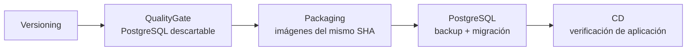

# Guion didáctico: migraciones PostgreSQL con EF Core

**Estado:** P1, P2 y P3 pasaron CI y se desplegaron sucesivamente en EC2; P3 es la versión activa. Build91 pasó con 49/49 unitarias y 13/13 integración, incluido HTTP 503 vía Nginx al caer PostgreSQL. También pasaron resiliencia, restore off-host y rollback P3→P1→P3. Las fases y sus objetivos exactos se declaran en [`schema-compatibility.json`](https://github.com/maxivalenzano/dev-ops-clase-2/blob/bdb2dca0e02a06e05378aba6741a3c01b14f917f/backend/schema-compatibility.json). El [plan de integración](./plan-integracion-postgresql-ef) conserva decisiones y criterios de aceptación.

## Objetivo

Mostrar cómo evoluciona PostgreSQL mientras varias versiones de la API siguen atendiendo solicitudes. P1 crea el esquema inicial; P2 agrega prioridad opcional; P3 completa datos previos y endurece las reglas. Backend, frontend y migrador se construyen desde un único SHA y etiqueta. `TASK_RELEASE` selecciona la versión del backend y `VITE_TASK_RELEASE` la del frontend.

## ¿Qué es una migración?

Una migración describe un cambio versionado del esquema: tablas, columnas, índices, restricciones o transformaciones de datos. EF Core registra las migraciones aplicadas en `__EFMigrationsHistory` y calcula cuáles faltan. Una migración no es un backup: puede quitar estructura o valores, pero no garantiza reconstruirlos.

## EF Core: `Up` y `Down`

- `Up` avanza del esquema anterior al nuevo. En P2 agrega `priority` nullable con `DEFAULT 2`.
- `Down` intenta revertir el cambio definido. Quitar `priority` elimina sus valores; agregarla otra vez no los reconstruye.
- Ambos son operaciones definidas en la migración; no son un backup ni una reversión transaccional general de la aplicación.
- El artefacto de migración se genera y revisa en Packaging. Las pruebas automatizadas contra PostgreSQL real descartable se ejecutan con `bash scripts/test-postgresql.sh`.

## Releases P1, P2 y P3

| Release | Migración objetivo | Evolución | Qué enseña |
| --- | --- | --- | --- |
| **P1** | `20261025000100_001_InitialTasks` | Tabla `tasks` inicial | CRUD y línea base |
| **P2** | `20261025000200_002_AddPriorityNullable` | `priority` nullable, default 2; API admite 1–3 y trata NULL como media | Cambio aditivo compatible |
| **P3** | `20261025000400_004_RequirePriority` | Incluye `003_BackfillPriority` y luego `NOT NULL` más `CHECK (priority BETWEEN 1 AND 3)` | Backfill y reglas de integridad |

Un default actúa cuando se omite el campo; no reemplaza un NULL explícito. En P2 se verificó con el marcador temporal: SQL confirmó `priority = NULL` y la API P2 lo representó como prioridad 2 (media). En P3 el backfill completó NULL como 2, y luego el marcador sobrevivió el rollback P3→P1→P3 con prioridad 3. El marcador se eliminó al finalizar; la consulta final dejó cero tareas.

## Pipeline y parámetros

`azure-pipelines.yml` contiene cinco stages en orden: `Versioning`, `QualityGate`, `Packaging`, `PostgreSQL` y `CD`.

- `deployDemo`: booleano, valor predeterminado `false`; debe seleccionarse `true` para solicitar despliegue manual en EC2.
- `releasePhase`: `P1`, `P2` o `P3`, por defecto `P3` para que un build nuevo no retroceda la versión de aplicación. La primera instalación debe seleccionar explícitamente `P1`; el script de preparación rechaza comenzar en P2/P3 sin una base P1 previa. Después, ejecutar P2 y P3 como releases separados, con `deployDemo=true` y la fase deseada.
- `QualityGate` ejecuta [`test-postgresql.sh`](https://github.com/maxivalenzano/dev-ops-clase-2/blob/bdb2dca0e02a06e05378aba6741a3c01b14f917f/scripts/test-postgresql.sh), que construye backend para cada fase y el migrador; [`test-postgresql.py`](https://github.com/maxivalenzano/dev-ops-clase-2/blob/bdb2dca0e02a06e05378aba6741a3c01b14f917f/scripts/test-postgresql.py) prueba las imágenes contra PostgreSQL descartable.
- `Packaging` publica backend, frontend y migrador bajo la misma etiqueta/SHA; los args son `TASK_RELEASE` y `VITE_TASK_RELEASE`.
- `PostgreSQL` ejecuta [`prepare-postgresql.sh`](https://github.com/maxivalenzano/dev-ops-clase-2/blob/bdb2dca0e02a06e05378aba6741a3c01b14f917f/scripts/prepare-postgresql.sh), incluyendo respaldo con [`backup-postgresql.sh`](https://github.com/maxivalenzano/dev-ops-clase-2/blob/bdb2dca0e02a06e05378aba6741a3c01b14f917f/scripts/backup-postgresql.sh), migración y validaciones.
- `CD` ejecuta [`deploy-ec2.sh`](https://github.com/maxivalenzano/dev-ops-clase-2/blob/bdb2dca0e02a06e05378aba6741a3c01b14f917f/scripts/deploy-ec2.sh), consume el recibo correspondiente a `BUILD_ID`, `IMAGE_TAG`, `SOURCE_COMMIT`, `RELEASE_PHASE` y `MIGRATION_TARGET`, y no vuelve a migrar.

## Guion de exposición: 15 minutos

| Tiempo | Paso | Pantalla y verificación que se muestra |
| --- | --- | --- |
| 0:00–1:30 | Contexto y parámetros | Azure Pipelines: cinco stages, `deployDemo` y `releasePhase`. Explicar que P3 es el default preventivo; para primera instalación se elige P1 explícitamente. |
| 1:30–3:00 | P1: primera instalación | Mostrar el run P1 guardado: esquema inicial, readiness y recibo BuildId/SHA/objetivo. No hace falta lanzar otra vez el pipeline durante la exposición. |
| 3:00–4:30 | CRUD e historial | Tablero y evidencia capturada: crear/listar/completar tarea; mostrar `tasks` y `__EFMigrationsHistory`, confirmando estado compartido y datos preservados. |
| 4:30–6:30 | P2: cambio aditivo | Mostrar el run P2 y el selector Baja/Media/Alta. Revisar la evidencia de compatibilidad P1 con esquema 002 y `priority` nullable/default. |
| 6:30–8:00 | NULL y backfill | Mostrar la evidencia P2: SQL confirmó NULL y la API lo leyó como 2. Luego seguir el mismo marcador en P3: `003_BackfillPriority` lo completó a 2. La tarea demo ya fue limpiada al cerrar las pruebas. |
| 8:00–9:30 | P3: restricciones | Mostrar el run P3 completado, `004_RequirePriority`, `NOT NULL` y `CHECK` 1–3. Señalar que `003` es el backfill explícito previo. |
| 9:30–11:00 | Repetición e idempotencia | Mostrar el resultado de CI contra PostgreSQL descartable: migraciones aplicadas sin duplicar datos, incluyendo la ruta desde esquema previo. Diferenciarlo de la base EC2. |
| 11:00–13:00 | Rollback de aplicación vs `Down` | Mostrar la secuencia manual real P3→P1→P3: el esquema 004 quedó intacto, la tarea se preservó y el retorno a P3 usó el recibo sin remigrar. Contrastar: `Down` quita columna/valores y no reconstruye prioridades; no ejecutarlo para rollback de aplicación. |
| 13:00–15:00 | Backup y restore | Mostrar backup91 descargado off-host, SHA-256 y restore en base nueva `restore_offhost_91_20261025`, con fingerprint coincidente y 0,462 s medidos para una fila. Ese tiempo no es un RTO general y el restore aislado no hace cutover productivo. |

La exposición usa evidencia guardada de los tres releases y pruebas, por lo que no requiere esperar que terminen tres pipelines durante la clase. Los artefactos y logs verificables están en las ejecuciones de Azure Pipelines y la bitácora. El rollback manual P3→P1→P3 y la prueba de resiliencia también se completaron.

Los scripts de EC2 necesitan variables y reserva de release que proporciona el pipeline; no deben invocarse a mano con valores arbitrarios. PostgreSQL se mantiene en el proyecto persistente [`compose.data.yaml`](https://github.com/maxivalenzano/dev-ops-clase-2/blob/bdb2dca0e02a06e05378aba6741a3c01b14f917f/compose.data.yaml), separado del rollback de aplicación. Los secretos se generan fuera de Git bajo `/opt/devops-lab/secrets` (directorio 0700, archivos 0444). La aplicación consume el archivo montado mediante `DATABASE_CONNECTION_FILE`.

La aplicación previa debe tolerar el esquema aditivo P2 durante la ventana entre migración y despliegue. La reserva serializa esa ventana para que releases no intercalen cambios.

## Tres operaciones diferentes de recuperación

| Operación | Qué recupera | Ejemplo / límite |
| --- | --- | --- |
| **Rollback de aplicación** | Imagen anterior | P2 a P1 puede mantener esquema P2 si la versión P1 es compatible. No restaura datos ni revierte esquema. |
| **Reversión de esquema (`Down`)** | Estructura según el `Down` de EF | Puede quitar la columna y sus valores. No reconstruye prioridades anteriores. |
| **Restore de backup** | Estado de una copia | Restaurar a una base separada, validar y cortar controladamente. Las escrituras posteriores al snapshot pueden faltar. |

Si una migración falla, consultar `__EFMigrationsHistory` y el esquema real; no asumir que todas las operaciones forman una transacción indivisible. Corregir hacia adelante o reintentar tras resolver la causa. [`backup-postgresql.sh`](https://github.com/maxivalenzano/dev-ops-clase-2/blob/bdb2dca0e02a06e05378aba6741a3c01b14f917f/scripts/backup-postgresql.sh) genera un dump custom y ensaya restore separado, validando fingerprints. Para volver a verificar una copia existente, usar [`restore-postgresql.sh`](https://github.com/maxivalenzano/dev-ops-clase-2/blob/bdb2dca0e02a06e05378aba6741a3c01b14f917f/scripts/restore-postgresql.sh): `bash scripts/restore-postgresql.sh BACKUP_DIR restore_nombre_unico`. El nombre debe comenzar con `restore_` y ser nuevo; el script valida checksum y contenido restaurado en esa base aislada, sin sobrescribir ni cambiar la base productiva. El backup también guarda globals/roles aparte del dump de la base.

## Verificaciones

El script de CI comprueba migración desde cero y desde fases previas con datos, repetición idempotente, restricciones, CRUD compartido y compatibilidad de las imágenes. En EC2, el stage PostgreSQL exige consulta autenticada, esquema objetivo compatible, backup con restauración comprobada en base separada y recibo sin secretos. CD verifica las tres réplicas, readiness y datos; si PostgreSQL falla, CD no se ejecuta.

La prueba de resiliencia enseña por qué deben coordinarse los timeouts: un intento inicial con timeout de conexión de 2 s aún produjo 504 en Nginx de 5 s porque DNS Unix/musl bloqueó. El commit `07e6c9a` añadió deadline ASP.NET de 2 s y propagación de cancelación a EF/Npgsql para tareas y readiness, dejando Chaos Lab fuera; `CancellationTimeout` es 500 ms. El commit `bdb2dca` agregó `dns_opt` con `timeout:1` y `attempts:1` a los backends y CI. Build91 pasó HTTP 503 vía Nginx y la verificación manual `--resilience` también pasó, con recuperación del servicio y datos.

Volumen persistente y backups no son alta disponibilidad: PostgreSQL y la aplicación comparten una VM. El retorno a Redis tampoco es rollback automático; requeriría transferencia inversa consistente.
