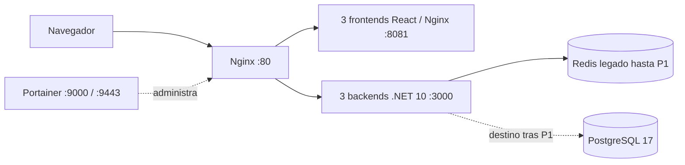

# Arquitectura y flujo del laboratorio

El proyecto es un laboratorio para observar balanceo, estado compartido y fallos de contenedores. La entrega existente en EC2 usa Redis hasta que se confirme el corte PostgreSQL P1. El repositorio incorpora PostgreSQL/EF Core y define su infraestructura persistente separada en [`compose.data.yaml`](../../compose.data.yaml); el despliegue remoto de esa arquitectura todavía está pendiente.

Las réplicas comparten imágenes; cada contenedor recibe su propio nombre. Al completar P1, PostgreSQL será la fuente de verdad y Redis quedará conservado como legado, sin recibir escrituras nuevas. La base y la aplicación comparten VM; no se protege ante caída del host.

## Motores de contenedores

- **Local:** Podman con Compose. Desde la raíz, ejecutar `podman compose up --build -d` y abrir `http://localhost` (o el puerto configurado en `PORT`).
- **Nube:** Docker y Docker Compose en la instancia Ubuntu EC2.

Azure DevOps sigue siendo la plataforma del pipeline de cuatro etapas, adaptado para publicar en GHCR y desplegar en EC2. Los scripts `scripts/run-pod.ps1` y `scripts/run-pod.sh` corresponden a un modo Podman Pod anterior y no representan la topología Compose actual.

## Migración a EC2

La migración está en curso. Docker Engine 29.9.2, Compose 5.6.1 y Buildx están instalados en EC2; el servicio está activo, `hello-world` pasó y `ubuntu` puede ejecutar Docker sin `sudo`. `/opt/devops-lab` está preparado y Compose/scripts ya se copiaron allí. El despliegue selecciona imágenes mediante `BACKEND_IMAGE`, `FRONTEND_IMAGE` e `IMAGE_TAG`, usando `scripts/setup-ec2.sh`, `scripts/deploy-ec2.sh` y `scripts/verify-deployment.sh`.

Redis será interno a la red Compose, con AOF y healthcheck, sin puerto publicado. Portainer queda enlazado a `127.0.0.1:9000` y `127.0.0.1:9443`. Para HTTPS, abrir el túnel con `ssh -i "C:\Users\m.valenzano\Downloads\vm-dev-ops-aws.pem" -L 9443:127.0.0.1:9443 ubuntu@18.216.227.211` y visitar `https://localhost:9443`.

La aplicación está desplegada como `3.0.0-build.81` en [http://18.216.227.211](http://18.216.227.211); los nueve contenedores están en ejecución. El agente `ec2-devops` está activo en `devops-ec2-env`. CI/CD 81 completó sus cuatro etapas y publicó Release `v3.0.0` y Deployment `ec2-demo`. Las imágenes backend y frontend comparten el SHA `3bbd09d848338f63efe6900c05a7004fde4281be`.

Como antecedente, la entrega anterior validó HTTP 200, persistencia Redis, failover frontend/backend y balanceo entre réplicas. La inspección de solo lectura más reciente observó EC2 en `3.0.3-build.85`, Redis vacío, 1.158 MiB disponibles y cerca de 15 GiB libres. No prueba PostgreSQL ni su despliegue. Los resultados históricos de Portainer pertenecen a la entrega previa.

CI/CD 81, 42 pruebas y el rollback descritos en registros anteriores se refieren a la arquitectura Redis y no validan el cambio PostgreSQL. El build local del frontend de la integración nueva pasó; CI, stages PostgreSQL/CD y P1/P2/P3 remotos permanecen pendientes de confirmación. La demo histórica usa HTTP por IP. Consultá la [bitácora PostgreSQL/EF](/bitacora/2026-10-25-postgresql-ef-migraciones) para el estado actual.
