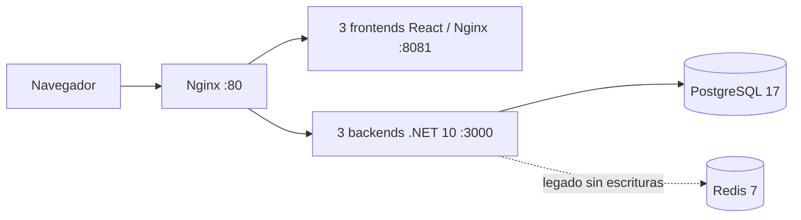

# Arquitectura y estado del laboratorio

El laboratorio ejecuta tres réplicas de frontend y tres de backend detrás de Nginx. Desde P1, PostgreSQL es la fuente de verdad de tareas; Redis y su volumen se conservan como legado y no reciben nuevas escrituras. PostgreSQL tiene un Compose persistente separado del rollback de aplicación en [`compose.data.yaml`](https://github.com/maxivalenzano/dev-ops-clase-2/blob/bdb2dca0e02a06e05378aba6741a3c01b14f917f/compose.data.yaml).



## Despliegue actual

EC2 está en P3 (`3.1.6-build.91`) con esquema `20261025000400_004_RequirePriority`. P1, P2 y P3 pasaron los cinco stages de Azure Pipelines y sus verificaciones finales. P2 mantuvo la tarea marcador de P1 y P1 respondió `/api/ready` como `UP` frente al esquema 002; P2 también respondió `UP` frente al esquema 004 durante la ventana previa a CD.

Build89 y build90 P3 fallaron en QualityGate: el POST de prueba a través de Nginx recibió 504 donde se esperaba 503 con PostgreSQL detenido; los stages posteriores quedaron omitidos. Build90 mostró resolución DNS Unix/musl bloqueante. Build91 añadió `dns_opt` y completó los cinco stages, con 49/49 unitarias y 13/13 integración, incluido 503 vía Nginx. Después también pasaron las pruebas manuales de resiliencia y rollback P3→P1→P3.

El pipeline actual tiene cinco stages: `Versioning`, `QualityGate`, `Packaging`, `PostgreSQL` y `CD`. Packaging obtiene la lista de IDs desde las migraciones EF del build; el stage PostgreSQL aplica automáticamente las pendientes y conserva una base que ya esté más avanzada. Rechaza historiales divergentes y no ejecuta `Down`. No existe selector de fase ni un ID objetivo fijo. P1/P2/P3 describen despliegues históricos en la [bitácora PostgreSQL/EF](../bitacora/2026-10-25-postgresql-ef-migraciones).

## Pruebas y desarrollo local

En Linux con Docker, la integración contra PostgreSQL descartable se ejecuta con:

```bash
bash scripts/test-postgresql.sh
```

Podman Compose en Windows/WSL tiene una limitación de red observada y no está validado para levantar este stack. No tratar `podman compose up` como quickstart soportado para PostgreSQL en ese entorno.

## Contexto histórico

La arquitectura previa usaba Redis como almacenamiento activo. CI81, build `3.0.0-build.81`, los nueve servicios y las pruebas Redis descritas en otras entradas pertenecen a ese período y no reflejan el despliegue actual. La inspección previa al corte PostgreSQL observó `3.0.3-build.85`, Redis vacío, 1.158 MiB de memoria disponible y cerca de 15 GiB libres; fue una inspección de solo lectura y no evidencia de que PostgreSQL estuviera instalado entonces.
