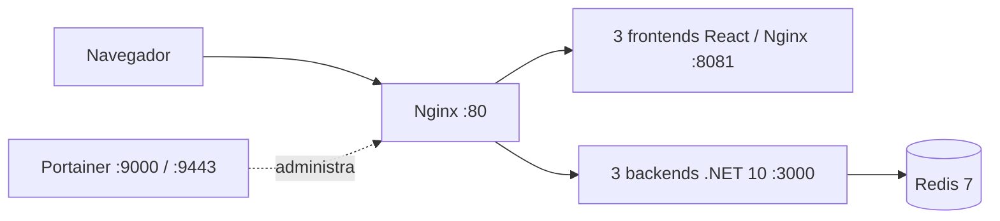

# Arquitectura y flujo del laboratorio

El proyecto es un laboratorio para observar balanceo, estado compartido y fallos de contenedores. La topología actual se define en [`compose.yaml`](https://github.com/maxivalenzano/dev-ops-clase-2/blob/main/compose.yaml): Nginx recibe el tráfico, tres réplicas sirven la SPA, tres réplicas exponen la API y Redis almacena las tareas. Portainer permite ver los contenedores.

Las réplicas de frontend y backend comparten imágenes; cada contenedor recibe su propio nombre de instancia. Redis mantiene las tareas compartidas en el volumen `redis-data`. La topología sirve para probar réplicas y fallos de contenedores dentro de una máquina; no protege ante la caída del host.

## Motores de contenedores

- **Local:** Podman con Compose. Desde la raíz, ejecutar `podman compose up --build -d` y abrir `http://localhost` (o el puerto configurado en `PORT`).
- **Nube:** Docker y Docker Compose en la instancia Ubuntu EC2.

Azure DevOps sigue siendo la plataforma del pipeline de cuatro etapas, adaptado para publicar en GHCR y desplegar en EC2. Los scripts `scripts/run-pod.ps1` y `scripts/run-pod.sh` corresponden a un modo Podman Pod anterior y no representan la topología Compose actual.

## Migración a EC2

La migración está en curso. Docker Engine 29.9.2, Compose 5.6.1 y Buildx están instalados en EC2; el servicio está activo, `hello-world` pasó y `ubuntu` puede ejecutar Docker sin `sudo`. `/opt/devops-lab` está preparado y Compose/scripts ya se copiaron allí. El despliegue selecciona imágenes mediante `BACKEND_IMAGE`, `FRONTEND_IMAGE` e `IMAGE_TAG`, usando `scripts/setup-ec2.sh`, `scripts/deploy-ec2.sh` y `scripts/verify-deployment.sh`.

Redis será interno a la red Compose, con AOF y healthcheck, sin puerto publicado. Portainer queda enlazado a `127.0.0.1:9000` y `127.0.0.1:9443`. Para HTTPS, abrir el túnel con `ssh -i "C:\Users\m.valenzano\Downloads\vm-dev-ops-aws.pem" -L 9443:127.0.0.1:9443 ubuntu@18.216.227.211` y visitar `https://localhost:9443`.

La aplicación está desplegada como `3.0.0-build.81` en [http://18.216.227.211](http://18.216.227.211); los nueve contenedores están en ejecución. El agente `ec2-devops` está activo en `devops-ec2-env`. CI/CD 81 completó sus cuatro etapas y publicó Release `v3.0.0` y Deployment `ec2-demo`. Las imágenes backend y frontend comparten el SHA `3bbd09d848338f63efe6900c05a7004fde4281be`.

Las pruebas de despliegue validaron HTTP 200 local y público, persistencia Redis tras reiniciar Redis y recrear un backend, failover frontend/backend, 30 solicitudes entre tres backends y 12 respuestas `frontend-info` de tres frontends. Redis empezó vacío, según confirmó el usuario. Portainer CE 2.45.3 está inicializado y su API autenticada confirma nueve contenedores; las credenciales de administración están guardadas localmente fuera del repositorio.

CI/CD 81, las 42 pruebas backend y los builds frontend y documentación pasaron. El rollback manual, la nueva entrega y el reinicio real de Ubuntu conservaron una tarea Redis de prueba; las verificaciones post-reinicio pasaron y luego la tarea se eliminó. La demo oficial usa HTTP por IP; dominio y HTTPS de aplicación son opcionales y no se ejecutaron. Podman en WSL no está validado; los detalles están en la [bitácora](/bitacora/). El helper de acceso a Portainer permanece local fuera del repositorio y no se publica.
